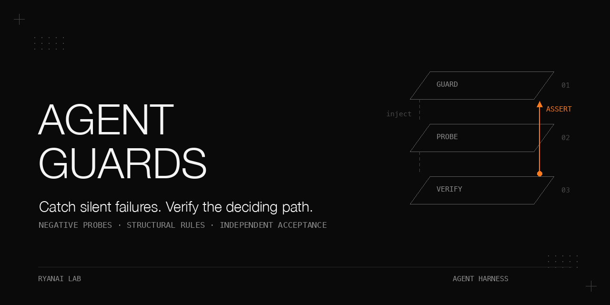

# Agent guards that fail silently

Negative probes, structural rules, and who is allowed to sign off.

A guard that silently stops working turns "unprotected" into "believed protected".
Between July and early October 2026, unattended coding-agent work exposed 25 cases in which a hook, gate, probe, scheduled job or fallback appeared healthy while its intended protection was absent.
None of the first ten was discovered by an alarm belonging to the failing guard.
The useful corrections were concrete: make a probe require the guard to act, assert the path that decided, validate receipts structurally, and separate the identity doing the work from the identity accepting it.
The limits matter just as much: a working alarm without an owner remains ineffective, and a local gate cannot authenticate evidence its actor can rewrite.

## Why this matters

A registered hook can miss the event it needs.
A command can exit successfully because the last process in a pipeline succeeded.
A canary can pass through a fallback while its main path stays dead.
A configuration key can survive validation without having a reader.
These are distinct failures with the same misleading surface: green without the required action.

This book pairs historical observations with small offline demonstrations.
Historical tables come from the supplied field records, not from running the demonstrations.
No real transcripts, ledgers, credentials, private detection patterns or reviewer reports are included.
The examples use the Python standard library and a POSIX environment; shell demonstrations that need `pipefail` use Bash.

## What is in this book

| Chapter | Question and mechanism |
|---|---|
| [A field guide to silent guard failures](docs/field-guide.md) | What went quiet? A dated collection of 25 cases and five failure families. |
| [Negative probes that run where the guard runs](docs/negative-probes.md) | What must happen? Registration, execution, environment, mirror and freshness checks. |
| [Probes that lie](docs/lying-probes.md) | Why was green unearned? Fifteen misleading checks and a path-sensitive canary. |
| [Config that exists but is not read](docs/config-readers.md) | Who consumes this key? Source-reader search followed by runtime acceptance. |
| [Structural rules beat blacklists](docs/structural-receipts.md) | Who printed this receipt? Simple calls, paired results and independent recomputation. |
| [Laziness versus forgery](docs/identity-separated-acceptance.md) | Who can rewrite the evidence? Local-gate attacks and the identity boundary. |

[Complete tables](docs/results.md), [expanded pitfalls](docs/pitfalls.md), and the [offline reproduction guide](docs/reproduce.md) provide the detail behind these summaries.

## Setting

| Item | Recorded condition |
|---|---|
| Machine | The historical cases were collected on one primary macOS workstation (model not recorded here). The shipped tests need no GPU and run on macOS or Linux. |
| Operating system and scheduler | macOS, launchd user agents; scheduler PATH `/usr/bin:/bin:/usr/sbin:/sbin`. |
| Language and shell | Python 3.14.6; macOS system bash 3.2.57; BSD grep 2.6.0 (FreeBSD). |
| The host coding agent | Command-line agent with command hooks, version 2.1.158 at audit time. |
| A second coding agent from another vendor | CLI 0.153.4 when its hook schema was read; used for review and shared hooks. |
| Hook events | `PreToolUse`, `PostToolUse`, `PostToolUseFailure`, `Stop`, `SessionStart`, `UserPromptSubmit`. |
| Audit population | 14 wired hook entries; 12 in the later registration matrix; 118 transcripts available on 2026-09-21. |
| Ledger snapshot | 1,878 lines, read 2026-10-03 at 19:32 local. |
| Offline prerequisites | Python 3.10 or newer, Bash, grep and a writable temporary directory. No GPU, model server or network. |

For deployment, a reader also needs an agent CLI with documented hook events and cron or launchd for a daily run.
Its effective environment and event schema are deployment prerequisites, not established by these fixtures.
No scheduler job is installed by this repository.

## Chapter 1: A field guide to silent guard failures

**Problem.** A healthy guard on a quiet day and a dead guard can both produce no warnings.
Counting silence without checking the population tells them apart only by accident.

**Mechanism.** Inventory each guard with its trigger, last action, observation source, duration and required external assertion.
The five families are exact-string checks, environment mismatch, exit-code or boolean checks, presence without effect, and the wrong observation scope.
For each guard, write "alive if and only if X happens" and choose an X that requires its intended action.

**Procedure as run.** The 2026-09-21 read-only audit listed 14 wired hooks and scheduled jobs, counted a 30-day ledger window cut at 2026-08-22, inspected suspiciously high or zero counts, and replayed failures in their actual environment.
Where no ledger existed, deny-text grep across 118 transcripts was a proxy: 3 of 118 sessions for one guard and 9 of 118 for another.
Stop latency came from recorded `durationMs`, not a new benchmark.

The collection below is abbreviated; [the field guide](docs/field-guide.md) retains every surface, cause, duration and discovery route.
Dates are in 2026; missing durations remain unknown.

| Case | Failed assertion | Recorded condition or result |
|---|---|---|
| 1 | A failure event reaches the reminder | Missing `PostToolUseFailure`; found 07-10; duration not recorded. |
| 2 | Main criteria decide the canary | 47 days, 07-07 to 08-23; degraded from the gate's first day, 07-08. |
| 3 | The sync progress marker advances | Frozen 07-08 to 09-14, 68 days; 2,374 samples, mean 80.5 s, median 72 s, max 165 s; after repair 100-300 ms, latest sample 99 ms. |
| 4 | The scheduler sees the intended environment | Duplicate dictionaries; 5 days, 08-18 to 08-23. |
| 5 | A fixture reaches escalation | All 141 of 141 logged counts were 1; 76 days, 07-07 to 09-21. |
| 6 | A reminder fixture actually fires | About 8 weeks, 07-26 to 09-21; audit said 55 days, calendar arithmetic gives 57; 2 all-history fires. |
| 7 | The dependency runs under scheduler PATH | 6 consecutive days; retained log had 7 FAIL lines, rc 127; real scheduler acceptance 09-21 23:26, "probe ok". |
| 8 | Shared patterns work in both engines | Python `re` and BSD `grep -E` disagreed; review 09-21/22; duration not recorded. |
| 9 | Shared hook copies match | 12 copies, 5 stale; 79 days, 07-08 to 09-25. |
| 10 | Each host's transcript produces parsed events | 237 empty states became fire 60 / clean 177; last 2 days, 30 sessions, clean 30 became fire 13 / clean 17. |
| 11 | Our agent gateway accepts its consumer's credential | 401 masked as 500 and hidden by fallback for 4 days, 09-02 to 09-06; correct credential gave six aliases 200. |
| 12 | The poller sees a used queue | 935 bytes, 13 startup lines; 65 days, 06-28 to 09-01, derived from dates. |
| 13 | Review policy resolves inside the worker profile | `None` became an exemption; about 2 days, 09-06 to 09-08. |
| 14 | A backup is fresh and its alarm is consumed | Newest bundle 1,896 hours / 79 days old; same alarm 2,016 times. |
| 15 | Recovery restores actual service | Restart policy `no`; down about 3 days, 09-29 to 10-02. |
| 16 | A live cache receives useful work | 0 keys, 3 commands, 1,010 connections in 6 days uptime; consumer pointed elsewhere. |
| 17 | The routing key has a reader | 0 readers; only a validator whitelist and a setup wizard; duration not recorded. |
| 18 | The job interprets payload and runtime correctly | Valid JSON with exit 1, then missing `node`, rc 127; 4 days, then 1 more day. |
| 19 | Listener identity matches scheduler identity | Health 200 came from an orphan process during one rollout. |
| 20 | The producer's exit code is checked | Pipeline returned `tail` status; third occurrence in six days. |
| 21 | Acceptance enters the guarded path | Missing two worker markers invoked an exemption; another assertion had no completed scan. |
| 22 | Debt belongs to the population shown it | 108 of 287 fires / 37.6% came from scheduled sessions in the 30-day window. |
| 23 | The index count equals reality | Claim 124, actual 340 / 2.7 times, for about two months; 3 true orphans. |
| 24 | Compliance is counted for the receiving agent | Frozen sample 07-27 to 09-21: **1 of 8 within the window, not attributable to the advice**; window: next 15 calls. |
| 25 | A broken state reader pauses the producer | Four scripts proceeded on missing, corrupt or unreadable state or missing Python; found pre-deploy. |

The public [axiom plugin](https://github.com/ryangu00/axiom) also had a silent-ledger defect: its stuck-search hook did not write a ledger event in enforce mode until its 2026-10 update.
That defect was fixed in the plugin's 2026-10 release.

**What did not work.** Process checks, open ports, unconsumed alarms and interactive-only acceptance all left failures undetected.
The first ten cases were found by audits, review, downstream symptoms, a spike or replay, not their own alarms.
The duration sample's median was 6 days, with seven of fifteen at 47 days or more; this selected sample says nothing about faults still silent.

**Rule.** Observe the action the guard must take, from outside the guard, in its real environment.
The [thinking-tier proxy cookbook](https://github.com/ryangu00/dell-pro-max-gb10-thinking-tier-proxy) gives the same requirement for a single proxy.

## Chapter 2: Negative probes that run where the guard runs

**Problem.** Presence checks cannot distinguish a guard that acts from a guard that does nothing.
A test in the wrong PATH or profile proves something about a different process.

**Mechanism.** The daily canary compares required events with registration, compiles required hooks, executes self-tests, compares mirrored bytes, and runs configured commands with exact output and status expectations.
Each probe exception becomes an alert; each run appends a JSON record with `ts`, `ok`, `alerts` and `checks`.
The self-test protocol is rc 0 **and** the word `PASS`; a must-have list prevents deleting a flag from silently removing coverage.
An edit-time hook compiles and tests newly edited hooks, warning through `hookSpecificOutput.additionalContext`.
A session-start status line shows red, stale after 72 hours, missing and unreadable states.

The historical canary had seven probes: registration, compile, selftest, content-gate, lane, review-lane and mirror.
The public version replaces private dependencies with argv-based command probes and an invented check-only label gate.
The matrix stays per guard: a failure reminder needs both success and failure events, while a write verifier needs `PostToolUse` and `Stop`.

**Procedure as run.** Registration and compilation arrived 2026-07-10; the 2026-09-21 audit expanded the matrix from 6 to 12 hooks and added deeper probes and edit-time tests.
Reviews and scheduler-triggered acceptance followed on 09-21/22; mirror comparison arrived 09-25.
The daily schedule was 09:40 local.

| Measurement | Recorded result and condition |
|---|---|
| Canary history, read 2026-10-03 | 93 records over 85 consecutive days, 2026-07-11 to 2026-10-03. |
| Red records | 4: review-lane transport failures on 08-19, 08-20, 08-21; cheap-lane rc 124 timeout on 09-24. |
| Return to green | 08-22 and 09-25; alert-to-green 3 days and 1 day. |
| Last 5 records, 09-29 to 10-03 | 5 of 5 clean, all 7 probes. |
| Recorded coverage lists | 17 records: 10 with 7 probes, 7 with 6; first 76 predate the field. |
| Index drift, 2026-09-16 to 2026-10-03 | 9 ok and 10 FAIL runs; last four failures were size only, 24,181 to 25,366 bytes against 24,000. |

Fault start times were not recorded; the daily schedule bounds detection, but detection latency was not measured.
The index gate found real problems without an owner to act on them.

**What did not work.** Source grep for a self-test flag accepted a comment-only fake.
An interactive dependency check missed scheduler rc 127.
The three-injection rule—guard broken, wiring broken, scheduling broken—was only partly implemented, not demonstrated for every guard.
The 14-day shadow rule and retirement when median alert-to-fix exceeds 3 days have little supporting data.

**Rule.** Make the guard fail deliberately, break its wiring, and make missed scheduling visible; accept deployment only after the target environment runs the probe.

## Chapter 3: Probes that lie

**Problem.** Probes can satisfy their own assertion without testing their intended subject.
A boolean, a grep match or an empty warning list does not identify what actually ran.

**Mechanism.** A secret-egress canary used a prefix plus 40 identical `x` characters.
The main criteria treated `xxxxx` as a redaction marker; a whitespace-stripping fallback still matched.
The boolean stayed true while the intended path stayed dead.
A correct left-boundary fix later removed that fallback match, and the self-test failure denied all egress.

The correction used a real-shaped, mixed-character canary, asserted `hit and basis == "main"`, and added ledger rows to both canary-failure and criteria-extraction denial branches.
The public toy builds an invented prefix at runtime and demonstrates the path error without shipping historical detection strings.

**Procedure as run.** Backups place the repair between 20:33 and 22:19 on 2026-08-23; the decision record is dated 08-24 UTC.
Five direct content cases checked the main-path canary, real-shape key, placeholder, boundary false positive and clean prose.
End-to-end checks then allowed the read-only probe and blocked a key-bearing outbound command.

| Measurement | Recorded result and condition |
|---|---|
| Wrong-path canary | 47 days; gate degraded from its first day, 07-08; fixed and verified within one evening. |
| Ledger at discovery | 957 lines, 0 canary rows. |
| Echoed-prompt acceptance | 4 of 4 models looked "OK" to grep; only 1 of 4 was usable; the other three were rejected by account type. |
| Repeated metadata warning | Same warning read as noise for 7 dispatches; it was the diagnosis. |
| Compliance recount | **1 of 8 within the window, not attributable to the advice**; next 15 calls, frozen 07-27 to 09-21; 5 never, 2 late. |

The compliance script missed sub-agent files containing 6 of 8 reminders; its initial "0 of 8" was not a valid count of receiving-agent behaviour.
Sibling searches also contaminated the ledger's 2 of 18 tally.

**What did not work.** Removing the correct boundary fix, weakening the fallback, or allowing egress after a failed security self-test were rejected.
A pure-function test also cannot prove its call site; the [model-swap cookbook](https://github.com/ryangu00/dell-pro-max-gb10-zero-downtime-model-swap) documents that distinction.

**Rule.** Require positive evidence, assert preconditions, and watch every probe fail for the right reason.
[The full chapter](docs/lying-probes.md) lists all fifteen lies and the version-specific regex table.

## Chapter 4: Config that exists but is not read

**Problem.** A valid configuration key can have no reader, or a reader in a different environment.
Repointing an unread key preserves the illusion of control.

**Mechanism.** Search the running source version for each key; exclude validator whitelists and installer defaults from evidence of reading.
Then follow the reader to its actual file, profile and environment, compare effective runtime state, and run the consumer once to assert the effect.
A stale copy of an authoritative catalogue becomes a pointer stub without the `services` structure, so parsing it fails instead of silently using old data.

**Procedure as run.** During the 2026-10-02 cleanup, the routing block had no readers; its only mentions were a validator and setup wizard.
Deletion was checked by parsing old and new configuration and comparing the exact expected difference, then running the gateway loader and structure validator.
No restart was needed for the unread keys; the fallback list was re-read at runtime.

| Case | Recorded result and condition |
|---|---|
| Dead routing block | 0 readers, 2 non-reader mentions; 3 blocks deleted, 2 provider definitions removed from 6 configs, 1 dead fallback list emptied. |
| Validation | 0 issues across 5 active configs; parse diff exactly matched expected deletions. |
| Stale catalogue copy | Revision 2026-09-26.02 versus authoritative 2026-09-28.1; replaced with a non-parseable pointer stub. |
| Wrong-profile reviewer | Before: 1 of 1 tested worker profile returned `None`; default home returned reviewer; after: 4 profile environments checked. |
| Duplicate scheduler dictionaries | 2 dictionaries; effective environment had 2 variables, escalation target and PATH. |

Our agent gateway's missing consumer credential was masked as 500 instead of 401 for 4 days; with the right key, 6 of 6 aliases returned 200.
Consumer acceptance required zero fallback lines, rather than a healthy port.

**What did not work.** An unread key remains unread after its target is fixed.
Deleting a stale copy invites reading older backups; a comment does not invalidate its structure.
Default-profile tests missed the worker-profile exemption.
The shipped literal search is a heuristic, not proof of a runtime read.

**Rule.** Find the reader, find what it reads, and test its effect in that reader's environment.

## Chapter 5: Structural rules beat blacklists

**Problem.** The actor can print a receipt-shaped line without recording anything.
Text-pattern defences lose to different shell compositions.

**Mechanism.** Accept a receipt only from a shell call whose first command basename is the receipt tool or verifier, whose command contains no `;`, `|`, `&`, backtick, `$(`, `<(` or newline, and whose paired direct result contains the expected OK literal and matching slug without a reported error.
The call and result are bound by `tool_use_id`; prose and sub-agent reports do not count.
Real receipts inside compound workflows are deliberately ignored; one standalone verify call resolves the reminder.

The warn-only verdict detects infrastructure writes, projects with at least 3 distinct non-exempt absolute file writes or publishing or a task done-flip, and research with at least 8 retrievals and no substantive write or receipt.
Distinct `.pdf` and `.docx` reads count once; a sub-agent result of at least 3,000 characters contributes 3 retrievals.
A clean record for the same task within 48 hours suppresses the done-flip trigger.
Infrastructure needs a worklog and receipt; projects need a changelog or worklog plus receipt; research needs a receipt or memory write.

An independent daily auditor recomputed verdicts from raw transcripts and queried note existence, deletion status, nonempty body and source scope directly.
The public auditor replaces the database with a caller-supplied nonempty-note-file check; it does not claim database equivalence or a separate OS identity.

**Procedure as run.** The 2026-07-07 specification moved from command mentions to structural receipts and independent checks.
Five forgery forms over four review rounds defeated token bans, literal matching and quote/escape stripping before the simple-call rule was accepted.
Acceptance included real incident and clean-session replay, a scheduled auditor run, rollback in both directions and a second-agent trigger.

| Measurement | Recorded result and condition |
|---|---|
| Plan review | 36 findings: 24 adopted, 8 partly, 4 rejected; before implementation. |
| Implementation review | 19 findings, all fixed; fresh-context cross-vendor review. |
| Forgery rounds | 4; reviewer constructions broke the orchestrator twice; ended with ship-OK. |
| Incident replay | One real session: fire, 39 project files, 6 done-flips, receipt missing; not shipped. |
| Scan performance | 82 MB in 0.57 s, single process; not a general benchmark. |
| First scheduled auditor run | 807 scanned, 44 debts. |
| Ledger at 2026-10-03 19:32 local | 387 fires / 383 distinct sessions, 7 clean records, 8 cleared debts, 94 auditor heartbeats, 1 with an error. |
| Fire population | Host 186; scheduled-agent lane 148; second agent 53; 148 of 387 / 38% unattended. |

**What did not work.** Blacklists, sub-agent self-report and trusting the hook's own conclusion failed.
The gate detects and the auditor confirms, but there is no evidence that closeout discipline improved: fires outnumber clears roughly 48 to 1, and clean rows record transitions only.
A same-name executable earlier on PATH and reuse of an existing slug remain accepted residuals.

**Rule.** Validate the structure of the call, then recompute from raw evidence; do not confuse a mistake-catcher with authentication.

## Chapter 6: Laziness versus forgery

**Problem.** A local fact gate was proposed as a substitute for independent review while its actor could write the snapshot, manifest and results.
More validation fields did not change who controlled the evidence.

**Mechanism.** The final attempted design used a registry, recursive snapshots, gate/template hashes, a manifest sidecar, 14 checks numbered 0 through 13, and a closeout checker.
Attacks rewrote the manifest and its hash together, selected another registry, or supplied a pass artifact that did not describe the current target.
Read-only mode bits did not separate ownership.
The generic toy reproduces those classes; its hardened variant fixes the registry path and reruns the check during closeout, while retaining the documented same-identity limitation.

**Procedure as run.** Fresh reviewers from another vendor used attacker posture and wrote reproductions; tests preceded fixes.
The fast lane was not merged after the final review.
A minimal shadow record and draft-only template were merged after three further review rounds; normal independent acceptance remained required.

| Round | Passing tests at review | Findings and condition |
|---|---|---|
| 1 | n/a | 18: 9 BLOCKER, 8 MAJOR, 1 MINOR; procedure and template. |
| 2 | n/a, static | 12 new: 3 BLOCKER, 6 HIGH, 3 MEDIUM; shell gate; 18 earlier items re-judged. |
| 3 | 13 of 13 | 11: 1 BLOCKER, 7 HIGH, 3 MEDIUM; Python gate v1, 541 lines. |
| 4 | 30 of 30 | 4 new: 2 BLOCKER, 2 HIGH, plus carry-over; gate v2 and closeout. |
| 5 | 43 of 43 | 11: 3 BLOCKER, 8 HIGH; gate v3; 85 recorded subprocess commands; DO-NOT-MERGE. |

In the task-board case, review reported 12 findings with zero false positives, while the record itemised 11: three bypass facts, five fixed and three declined.
Detection moved to the dispatcher's scan: first-day acceptance covered ten boards with 0 baseline flags, 1 bypass flag without changing the card, a valid child predating the parent by 17 s, and a count that stayed 1 after rescanning.
The tool layer remained fail-open, the strict scan only flagged, and no safe automatic reopen contract was established.

**What did not work.** Neighbouring hashes, writable result files, mtime cutoffs, first-match lane text and repeated reviews did not create a trust boundary.
The 43 tests used hand-written closeout artifacts; they were not end-to-end evidence of the real gate.
Round-five raw JSON is gone; only the report's command table survives.

**Rule.** Decide a stop-loss before review: after more than three rounds still returning blockers, revisit the threat model.
Forging resistance needs an independent identity that reruns the fact and controls anchors the actor cannot write; that boundary was designed but not built.
The [held-out evaluation cookbook](https://github.com/ryangu00/westpoint-agent-eval-rigged-sandbox) applies the same principle to answer keys outside a sandbox.

## Rule cards

1. Define "alive if and only if X happens", where X requires the guard to act and is observed externally.
2. Use a negative probe: an input that requires action, and an assertion that the action occurred.
3. Run acceptance in the scheduler, profile and process environment the guard actually uses.
4. Assert the deciding path and use a canary shaped like the thing the gate must catch.
5. Require self-test rc 0 plus PASS; retain a must-have list when source flags disappear.
6. Run a guard's self-test in the same edit; the adopted shadow period is 14 days, with limited supporting data.
7. Find a configuration key's reader, verify its input source, and test its runtime effect.
8. Link copies that must match; compare bytes as a backstop; replace stale copies with non-parseable pointers.
9. Validate the structure of a receipt-producing call instead of adding text patterns.
10. Actor-writable evidence supports mistake-catching; independent acceptance needs protected anchors and a separate identity.
11. Show stale and missing as explicitly as red; assign an alarm owner or stop its producing line.

## Pitfalls

| Symptom | Root cause | Fix from the case record |
|---|---|---|
| Green hook, no action | Missing event or unreachable branch | Registration matrix and a fixture reaching that branch. |
| Works in a terminal | Scheduler PATH/profile differs | Empty-environment probe, then a real scheduler run. |
| Canary passes through the wrong path | Boolean accepts fallback | Assert the deciding path and representative input shape. |
| Self-test disappears without an alarm | Source flag was coverage | Execute rc/PASS protocol and keep a must-have list. |
| Configured feature stays inert | No reader or wrong source | Source-reader check, effective-state check, consumer run. |
| Receipt can be printed by another command | Compound shell result mixes producers | Simple-call rule and independent existence check. |
| Forged result passes closeout | Actor owns its evidence | Recompute; keep independent acceptance and protected anchors. |
| Repeated red with no repair | No owner consumes the alarm | Show red/stale/missing at work start; ownership remains unresolved here. |

[Expanded pitfalls](docs/pitfalls.md) include parser scope, mirror replacement, dual-engine regexes, duplicate debts and empty assertions.

## Reproduce it without our infrastructure

These commands run from the repository root. Keep disposable state inside the checkout:

```bash
mkdir -p .work
export TMPDIR="$PWD/.work"
export PYTHONDONTWRITEBYTECODE=1
python3 -m unittest discover -s tests -v
python3 scripts/hook_canary.py --self-test
python3 scripts/hook_selftest_on_edit.py --selftest
python3 scripts/hook_canary.py --config configs/canary.example.json
python3 examples/path_canary.py
python3 scripts/receipt_gate/test_forgery.py
```

The unit suite constructs synthetic settings, faults, transcripts, notes and attacker-owned state in temporary directories and removes them afterwards.
The configured canary appends a synthetic result under `.work`; it performs no network calls.
Follow [the full reproduction guide](docs/reproduce.md) for the scheduler PATH failure/recovery, status states, index repair limits, reader check, lying probes and each toy forgery.
Negative cases are expected to exit nonzero; their detection is the successful outcome.
These runs validate the public examples, not historical deployment acceptance or the historical review counts. [Recorded validation](docs/validation.md) gives the exact local result lines.

## Limits and open questions

[The full limits](docs/limits.md) retain the unresolved findings and evidence gaps.

- The 25 cases were found, not sampled randomly; unseen faults and canary false negatives are unknown.
- One operator's macOS setup and the recorded agent versions constrain generality; other schedulers and schemas need their own acceptance.
- Four red records over 85 days were real alarms, but their denominator is not the number of possible faults.
- The index gate failed on 10 of 19 recorded runs for real reasons without an owner; detection did not produce consumption.
- The receipt gate has no labelled false-positive rate, quality measure or demonstrated improvement in discipline.
- Five forgery forms from one reviewer family are not an open-ended security evaluation; PATH substitution and slug reuse remain.
- Cross-vendor adoption counts are not independently audited; the private round-five raw JSON cannot be recreated.
- The toy is not the original domain gate, and the hardened toy still trusts actor-writable snapshots.
- The 14-day shadow period and more-than-3-day retirement threshold have little empirical support.
- No external watchdog beyond the 72-hour status line was established in the sheet; separate-user or signature-based anchors were not built.
- The public plugin's compliance page was not checked online for later changes; the frozen wording here must not be treated as a current effectiveness estimate.

## Files

- `docs/` — complete tables, expanded pitfalls, chapter mechanisms, [implementation map](docs/files.md), reproduction guide and banner source.
- `scripts/hook_canary.py`, `configs/`, `examples/hooks/` — configured registration, compile, self-test, command and check-only probes.
- `scripts/hook_selftest_on_edit.py`, `env_probe.sh`, `daily_probes.sh`, `status_line.py` — edit-time and scheduler examples, freshness and visible status.
- `scripts/index_drift_check.py`, `is_paused.sh`, `config_reader_check.py` — count/size invariants, fail-closed state and literal reader search.
- `scripts/receipt_gate/` — generic verdict core, auditor, synthetic generator, toy writer and forgery tests.
- `scripts/toy_gate/` — intentionally forgeable reference gate, hardened variant and the three local forgery demonstrations.
- `examples/path_canary.py`, `examples/lies/` — runtime-built canary and executable misleading-check examples.
- `tests/` — standard-library offline acceptance; no private fixtures.


## Related cookbooks

- [axiom](https://github.com/ryangu00/axiom) — silent guard death, SessionStart health checks, heartbeat records, egress self-tests and same-permission limitations.
- [westpoint-agent-eval-rigged-sandbox](https://github.com/ryangu00/westpoint-agent-eval-rigged-sandbox) — held-out answer keys outside the actor's sandbox.
- [dell-pro-max-gb10-thinking-tier-proxy](https://github.com/ryangu00/dell-pro-max-gb10-thinking-tier-proxy) — a launch probe that fails if the proxy does nothing.
- [dell-pro-max-gb10-zero-downtime-model-swap](https://github.com/ryangu00/dell-pro-max-gb10-zero-downtime-model-swap) — silent pass-through and the limits of pure-function tests.

Only repositories named as published in the supplied sheet are linked; sibling links assume the same public repository owner and were not checked online.

## License

Apache-2.0. See [LICENSE](LICENSE).
